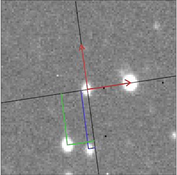
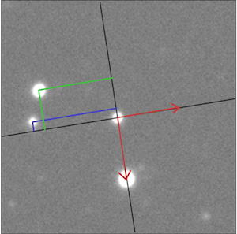

# StarMatch

**Marek Gorski and Dominika Switlik**

Fast astrometry of star lists (e.g. daophot photometry) against a sky catalogue such as **Gaia**:
pixels ↔ RA/Dec, with a FITS WCS header as output. As an option, it can also compute the transformation
between two instrumental (pixel) star lists. The only dependency is numpy.

```python
from starmatch import match_sky

r = match_sky("FS001_121011_1_J.ap", "FS001_gaia.txt", pixscale=0.288, epoch="2012-10-12T01:46:40")
r                                  # SkyMatchResult(n=19 stars, rms=0.066", pixscale=0.2880"/px, PA=269.97 deg, order=1)
ra, dec = r.transform.pix_to_sky(x, y)
x, y = r.transform.sky_to_pix(ra, dec)
r.wcs_header()                     # FITS WCS (RA---TAN or RA---TAN-SIP)
```

```python
from starmatch import match        # option: two pixel lists

r = match("reference.ap", "field.out", pixscale=0.368)   # HAWKI field, SOFI reference
r.transform.field_to_ref(x, y)
```

## Installation

Requires Python ≥ 3.9 and numpy.

```console
git clone https://github.com/astromg/starmatch.git
cd starmatch
pip install .                 # library + `starmatch` command
pip install -e ".[notebook]"  # + jupyter, matplotlib (example notebook)
pip install -e ".[wcs]"       # + astropy (r.transform.wcs() returns an astropy WCS)
pip install -e ".[dev]"       # + pytest, ruff, astropy
pip install -e ".[gui]"       # + FitsView, PyQt5 (examples/gui)
```

## Command line

```console
# 1. Gaia DR3 around the image (position from the FITS header; VizieR, needs internet)
starmatch gaia --fits image.fits --radius 5 -o gaia.txt
# 2. astrometry; the epoch for proper motions is taken from DATE-OBS
starmatch sky image.ap gaia.txt --pixscale 0.288 --fits image.fits --wcs image.wcs --pairs image.pairs

# option: two pixel lists
starmatch pix reference.ap field.out --pixscale 0.368 -o field.xytr
starmatch reference.ap field.out                      # old syntax = starmatch pix
```

| `sky` option | meaning |
|---|---|
| `--pixscale` | pixel scale [arcsec/px], required, must be known to about ±3% |
| `--epoch` / `--fits` | epoch of the observation (year or ISO date), or FITS image to read `DATE-OBS` from |
| `--flip` | `auto` (default) tries both parities; `no`: usual sky orientation; `yes`: mirrored |
| `-o` | solution file `.radec` (default: `<field>.radec`) |
| `--wcs` | FITS WCS header cards (text, 80 characters per card) |
| `--pairs` | list of matched stars: `id x y mag id_cat ra dec mag_cat dxi deta` |
| `--tol`, `--nb-use`, `--axis-stars`, `--order`, `--method` | see [Parameters](#parameters) |

The `pix` sub-command takes the same options. There `--pixscale` is the pixel scale ratio
field/reference (default 1), the output is a `.xytr` file, and `--flip` defaults to `no`.

## Library

The example notebook
[`examples/notebooks/starmatch_examples.ipynb`](examples/notebooks/starmatch_examples.ipynb) has
plots. Part A covers astrometry and part B covers two pixel lists.

### Astrometry: `match_sky(field, catalog, pixscale, epoch=None, ...)`

- **`field`**: a pixel star list. It can be a daophot file (`.ap`, `.out`, `.coo`, `.lst`, `.als`,
  …), a text file with columns `ID X Y MAG`, a `Catalog`, `(x, y, mag)`, an (N, 3) array, or a
  table/dict with `x, y, mag`. Coordinates follow the FITS/daophot convention: the centre of the
  first pixel is 1.
- **`catalog`**: a sky catalogue. It can be a text or CSV file with columns `ra dec mag [pmra pmdec]`,
  with or without a header (Gaia archive and VizieR column names are recognised, `--` means missing),
  a `SkyCatalog`, `(ra, dec, mag)`, or a table with ra/dec/mag columns. `query_gaia(ra, dec,
  radius_arcmin)` (module `starmatch.gaia`) downloads Gaia DR3 from VizieR.
- **`epoch`**: positions are moved with proper motions from the catalogue epoch (Gaia DR3: 2016.0)
  to the epoch of the observation. `pmra` is μα·cos δ in mas/yr.
- `read_fits_header(path)` reads the FITS header without astropy, for `DATE-OBS`, `RA`, `DEC` and
  `ESO INS PIXSCALE`.

The result, `SkyMatchResult`:

| attribute | meaning |
|---|---|
| `transform` | `SkyTransform`: `pix_to_sky(x, y)`, `sky_to_pix(ra, dec)`, `pixscale` ["/px], `rotation` (PA of the +y axis, east of north), `flipped`, `wcs_header()`, `wcs()` (astropy) |
| `n`, `rms`, `order` | number of matched stars, residual rms [arcsec], polynomial order (1 or 2) |
| `field_idx`, `cat_idx` | indices of the matched stars in the star list and in the catalogue |
| `residuals` | (n, 2) catalogue − fit in (ξ, η) [arcsec] |
| `radec()` | RA, Dec of all stars in the list |
| `catalog` | the catalogue moved to the epoch of the observation |
| `save(path)`, `save_wcs(path)`, `save_pairs(path)` | `.radec` solution / FITS header cards / matched stars |

The `.radec` file stores the tangent point and the polynomials pixel → (ξ, η) [arcsec] and back,
in the same layout as `.xytr`. `load_sky_transform(path)` reads it back.

### Two pixel lists: `match(ref, field, pixscale=1, ...)`

The result, `MatchResult`:

| attribute | meaning |
|---|---|
| `transform` | `XYTransform`: `field_to_ref(x, y)`, `ref_to_field(x, y)`, coefficients `fr_x, fr_y, rf_x, rf_y`, `scale`, `rotation`, `flipped` |
| `n`, `rms`, `order` | number of pairs, residual rms (field → reference, reference px), polynomial order |
| `ref_idx`, `field_idx`, `ref_id`, `field_id` | indices / star IDs of the matched stars |
| `ref_xy`, `field_xy`, `residuals` | (n, 2) arrays |
| `save(path)`, `save_pairs(path)` | `.xytr` file / list of matched stars |

`.xytr` format:

```
# reference=ref.ap field=field.ap
# x' = px[0] + px[1] * x + px[2] * y + px[3] * x*y + px[4] * x*x + px[5] * y*y
F2R Px=  ...      (field -> reference)
F2R Py=  ...
R2F Px=  ...      (reference -> field)
R2F Py=  ...
```

Both functions raise `MatchError` if no significant solution is found. The most common cause is a
wrong `pixscale`.

The old attribute-style class `StarMatch` (`sm.ref_xr = ...; sm.go(); sm.p_fr_x`) and the functions
`loadap`, `loadout`, `load_file`, `loadxytr`, `saveP2file`, `coo_trans` still work.

## Algorithm

`match_sky` projects the catalogue onto the tangent plane: a gnomonic (TAN) projection around the
catalogue centre, with standard coordinates ξ (east) and η (north) divided by `pixscale`. It then
runs the same engine as `match`, once for each parity unless `flip` is given. The final polynomials
pixel ↔ (ξ, η) are fitted to the matched pairs.

The engine (`match`):

1. **Selection.** The brightest stars are taken from both lists, at most `nb_use` from the
   reference. Their numbers keep the same magnitude depth: the field gets `starratio` × as many
   stars, and `starratio` defaults to the ratio of the areas the two lists cover. This matters when
   the catalogue covers a larger area than the image.

2. **Local features.** The feature radius is chosen so that it holds on average `nbStarsRadius`
   reference stars, and in the field it is scaled by `pixscale`. For each star, _axis1_ points to
   the brightest neighbour and _axis2_ is its normal. The vectors to the other neighbours are
   projected onto both axes and scaled by the distance to that neighbour. The projections, in
   magnitude order, do not depend on scale or rotation.

    

   In the reference, the axis can also be the 2nd, 3rd, … brightest neighbour (`axis_stars`). This
   helps when the brightness order differs between bands (Gaia G vs J/K). Features are computed for
   `nbPCent_match` of the selected stars, but for at least `min_feature_stars`. Arrays are compared
   element by element (k, k+1, k−1, within `starlist_error`), and brighter neighbours score more.
   Every reference star gets the field star with the best score as a _candidate_, if the score is
   above `min_score`.

3. **Consensus.** Every pair of candidates defines a similarity transformation (shift, rotation,
   scale). Models whose scale differs from `pixscale` by more than 3% are dropped. The model that
   agrees with the most candidates (within `tol`) wins. All pairs are checked, so the result is
   deterministic and still correct when most candidates are wrong.

   **Triangles, used for few stars.** If steps 2–3 fail (`method="auto"`), or if
   `method="triangles"` is set, the initial solution comes from triangles instead:
   - all triangles are built from the `triangle_stars` (25) brightest field stars and the
     corresponding number of brightest reference stars;
   - two triangles match if their longest sides agree after scaling by `pixscale` (±3% + `tol`),
     their side ratios agree (about 1.5 px relative to the side) and their orientation is the same;
   - every matching pair of triangles gives a similarity model, and the model supported by the most
     bright stars wins, with at least 4 (the triangle itself plus one more).

   This needs only 3 stars instead of ~10 neighbours per star, so it works with 10–20 stars in the
   image. On all real data in `examples/data` both methods give identical pairs.

4. **Refinement.** All stars are transformed and paired with their nearest neighbour, one to one.
   The polynomial is fitted by least squares with `clip`·σ clipping, and this is repeated `n_iter`
   times with a shrinking radius. The polynomial is 2nd order from 30 pairs up, otherwise linear
   (`order`).

5. **Acceptance.** Close pairs are counted using *leave-one-out* residuals: each pair is compared
   with the fit made without it. This stops a fit with few pairs from pulling random pairs together.
   A pair is close if this residual is within `tol`/3. The count is compared with the chance level,
   measured by shifting the solution by 10·`tol` in 8 directions and counting only stars that stay
   inside the field. The solution is accepted if there are at least 6 close pairs and
   (close − chance)/√chance ≥ 5. Otherwise everything is repeated with 2× `nb_use`, up to
   `max_nb_use`, then with triangles, and then `MatchError` is raised.

### Parameters

| parameter | default | meaning |
|---|---|---|
| `pixscale` | — | `match_sky`: arcsec/px; `match`: pixel scale ratio field/reference. ±3% |
| `epoch` | None | `match_sky`: epoch of the observation (proper motions) |
| `flip` | auto / False | parity; `None` tries both (default in `match_sky`) |
| `tol` | 3 px | tolerance of the initial (shift + rotation + scale) solution; must cover the distortion |
| `nb_use`, `max_nb_use` | 400, 1600 | brightest reference stars for steps 1–3; retries up to `max_nb_use` |
| `starratio` | auto | field/reference ratio of star numbers in the same magnitude range |
| `axis_stars` | 2 (sky), 1 (pix) | neighbours tried as the feature axis in the reference |
| `nbPCent_match`, `min_feature_stars` | 0.25, 100 | stars with local features |
| `nbStarsRadius` | 10 | average number of neighbours in the feature radius |
| `starlist_error`, `min_score` | 0.05, 0.3 | feature comparison tolerance and threshold |
| `n_iter`, `clip` | 4, 3.0 | refinement iterations, sigma clipping |
| `order` | auto | polynomial order 1 or 2 (auto: 2 from 30 pairs) |
| `method` | auto | initial solution: `features`, `triangles`, or `auto` (features, then triangles) |
| `triangle_stars` | 25 | brightest field stars used for triangles |

Fixed constants in the code (`starmatch/core.py`):
- 3% scale tolerance in the consensus and in the triangles;
- at least 6 close pairs, 5σ significance, 30 pairs for the 2nd order;
- a minimum matching radius of 0.3 px;
- at most 32 neighbours per feature and at most 20 000 consensus models;
- triangle support ≥ 4.

### Units and conventions

- `rms` is the 2D rms, √(mean(dx² + dy²)), in reference pixels (`match`) or arcsec (`match_sky`).
- `tol` is in reference pixels in `match`, and in image pixels in `match_sky`.
- `SkyTransform.rotation` is the position angle of the +y pixel axis, east of north (0 = north up).
  `flipped=False` is the usual orientation as seen from the ground: east is counter-clockwise from
  north, i.e. east is left when north is up.

### Limits (measured, see Tests)

- `pixscale` must be within about ±3%.
- Success rate by the number of catalogue stars in the image (synthetic tests with a colour scatter
  of 0.5 mag between catalogue and image):

  | stars | success |
  |---|---|
  | ~6 | ~40% |
  | ~9 | ~70% |
  | ~12 | ~98% |
  | ≥17 | 100% |

  When matching fails, it raises `MatchError` and never returns a wrong solution: 0 false matches in
  582 unrelated sky fields and 340 unrelated pixel fields.
- Distortion beyond `tol` (default 3 px) relative to shift + rotation + scale needs a larger `tol`.

## Tests

```console
pip install -e ".[dev]"
pytest
```

74 tests cover:
- **synthetic images of a known sky:** all orientations and both parities, proper motions,
  distortion, few stars (down to ~12, triangles), unrelated catalogues (must fail, also with few
  stars), and the FITS WCS checked against astropy (< 1 mas);
- **real data:** FS001 with Gaia, compared with the 2024 prototype (all 15 of its pairs found,
  plus 4 more; positions agree to 0.03″ median);
- **two pixel lists:** synthetic transformations, unrelated fields, the 3 real pairs in
  `examples/data/`, and the vectorized features compared with the original loop implementation;
- **readers, CLI and the Gaia response parser.**

Benchmark used during development:

| | result |
|---|---|
| pixel matching | 17 scenarios × 10 all solved; 0 false matches in 340 unrelated fields |
| sky matching | 0 false matches in 582 unrelated fields; 100% from ~17 image stars |
| transformation error | ~0.02–0.1 px |
| real SOFI/HAWKI pair | ~20 ms |

## Repository layout

```
starmatch/         sky.py (match_sky), core.py (match engine, StarMatch), transform.py, io.py, gaia.py, cli.py
tests/             pytest
examples/data/     daophot files: FS001 (+ Gaia catalogue), FS114, SOFI J/K pairs, HAWKI chip 3
examples/notebooks/starmatch_examples.ipynb
examples/gui/      FitsView viewers (starmatch_view.py, experimental coofind.py)
docs/img/          figures used in this README
```

## Changes

### 0.3.0
- **Astrometry against Gaia** (`match_sky`, `starmatch sky`). This ports the 2024 prototype to the
  new engine and adds:
  - proper TAN projection;
  - proper motions with the cos δ factor;
  - automatic parity;
  - FITS WCS output (TAN / TAN-SIP with inverse);
  - Gaia download (`starmatch gaia`);
  - `read_fits_header`.
- `axis_stars`: the feature axis can be one of several brightest neighbours. This replaces
  `max_asterism_rotation` from the prototype.
- Automatic `starratio` from the covered areas: small images in large catalogues now match
  reliably.
- **Triangles for few stars** (`method`): with ~12 image stars the success rate rose from 60% to
  98%. The significance test now uses leave-one-out residuals and a chance level limited to the
  field area.
- Linear transformation for fewer than 30 pairs (`order`). `flip` for mirrored pixel lists.

### 0.2.0
- Deterministic **consensus** instead of random triangles, **refinement** on all stars, and a
  significance test.
- `match()` with `MatchResult`, ~5× faster, ~7× more accurate.

### 0.1.0
- Installable package, CLI, notebook, tests. Bug fixes: magnitudes sorted as text in the CLI, and
  the wrong star in the second triangle pass.

## ToDo

- Optionally skip undefined magnitudes (`99.999`) when loading `.ap` files.
- Automatic `pixscale` search when it is not known.
